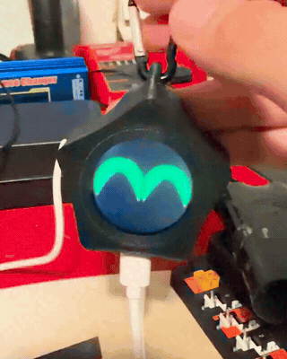
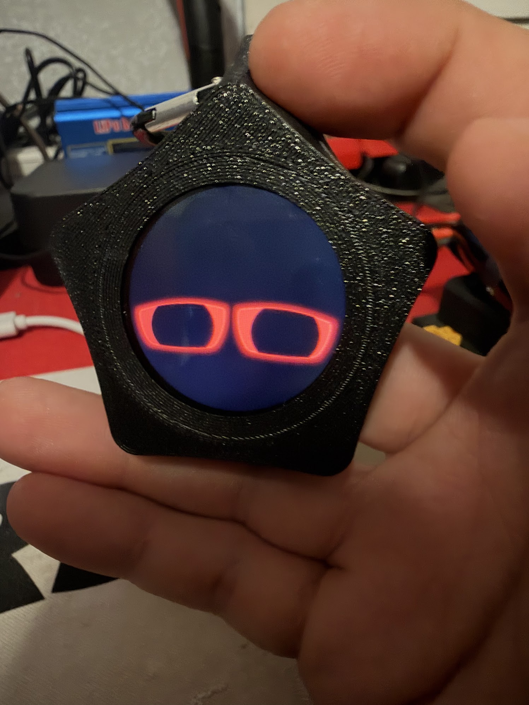
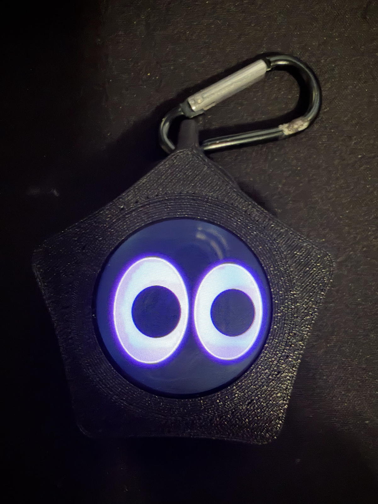
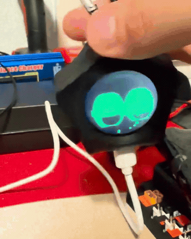
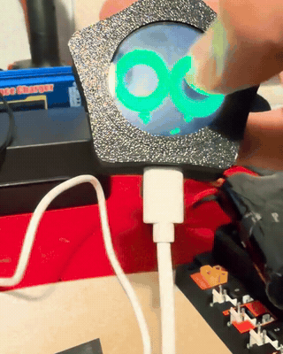
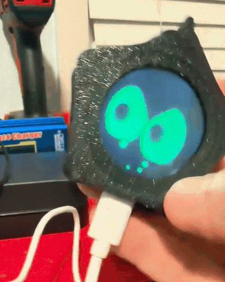

# Star

A pocket-sized **Glowling** whose personality lives in its eyes.
Built for the Waveshare ESP32-S3-Touch-LCD-1.28. Drawn on-device; no Wi-Fi or cloud required.

## A little personality

| Happy while charging | Low battery, low spirits | Neutral and looking around |
| :---: | :---: | :---: |
| <picture></picture> | <picture></picture> | <picture></picture> |
| Green bubbles rise through happy eyes. | Tired red eyes as the battery runs low. | Neutral purple eyes. |

## In motion

Real footage from the assembled keychain, shown as silent GIFs.

| Touch reactions | Battery check | Shake → dizzy |
| :---: | :---: | :---: |
| <picture></picture> | <picture></picture> | <picture></picture> |

## Controls

Hold Star with USB-C at the bottom.

| Action | What happens |
| --- | --- |
| Touch once while asleep | Wake; lift before interacting again. |
| Tap / move a finger | A boop or finger-following gaze. |
| Double-tap near the same spot | Center left/right **and** up/down at the current pose. |
| Tap, then hold the second press | Toggle always-on. Start the second press within 420 ms; hold 850 ms. |
| Swipe up / tap ten times | Show the battery. Keep tap gaps under 650 ms. |
| Swipe down / left / right | Sad / shy / happy. |
| Three–five quick taps | Angry eyes; five taps start a brief protected pause. |
| Tilt / rock / shake | Tracking, contentment or dizzy spirals. A brisk left/right shake can also wake it. |

Normal sleep: **30 seconds after waking**, then **15 seconds from each touch**.
Always-on shows tiny falling stars in the pupils, dims and drops to 10 FPS after 20 seconds
without touch or handling. Repeat the shortcut to restore sleep; restart resets the mode.

## Charging and battery

Green bubbles rise into the happy charging eyes. After unplug detection, the last
bubbles finish before the green fades. Low charge makes the eyes red and tired.

Charging is inferred from voltage, so startup connections and near-full unplugging
can be missed. Estimates of **95% and above display as 100%**; this is not proof of
full charge. Critical low battery overrides always-on.
[Measured limitations](docs/charging-test-2026-10-15.md).

## Animation gallery

[Expressions, behaviors and effects](ANIMATIONS.md) ·
[All five renderer sheets](ANIMATIONS.md#rendered-gallery) ·
[Always-on starfall](docs/animations/07-always-on-starfall.gif) ·
[Double-tap zero](docs/animations/08-double-tap-zero.gif)

## Build and upload

<details>
<summary>Arduino setup and CLI commands</summary>

1. Open [StarFace/StarFace.ino](StarFace/StarFace.ino) in Arduino IDE.
2. Install **esp32 by Espressif Systems** (recorded build: **3.3.11**).
3. Select **ESP32S3 Dev Module**, **16 MB flash**, **QSPI PSRAM**,
   **USB CDC On Boot: Disabled**.
4. Connect USB-C, select the serial port, and upload. Touch once to wake.

Drivers are included. If upload needs manual bootloader entry: hold **BOOT**,
press **RESET**, release **BOOT**, and retry. Serial Monitor: **115200 baud**.

From the repository root, with the core installed:

```sh
arduino-cli compile --fqbn esp32:esp32:esp32s3:FlashSize=16M,PSRAM=enabled,CDCOnBoot=default --build-path build/firmware Keychains/Star/StarFace
arduino-cli upload --fqbn esp32:esp32:esp32s3:FlashSize=16M,PSRAM=enabled,CDCOnBoot=default --port YOUR_PORT --input-dir build/firmware Keychains/Star/StarFace
```

Replace `YOUR_PORT` with the board's serial port.

</details>

[Developer guide](docs/DEVELOPMENT.md) · [Tests and previews](tools/preview/README.md) ·
[Reports](docs/README.md) · [Media](docs/media/README.md) · [Research](RESEARCH.md)

Part of [Glowlings](../../README.md). Inspired by [CREATURE's Starboy](https://hesjustalittleguy.com/).
[MIT](../../LICENSE); included Waveshare drivers retain their notices.
