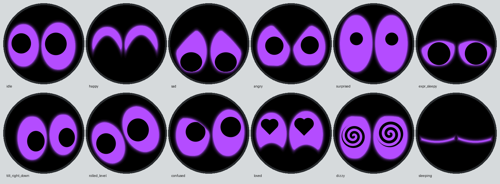
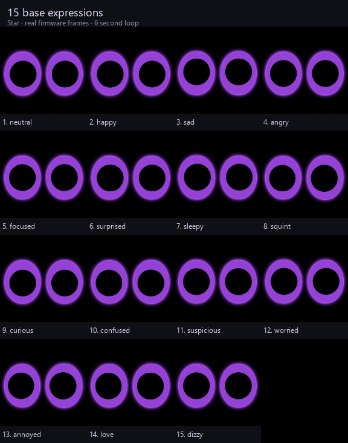
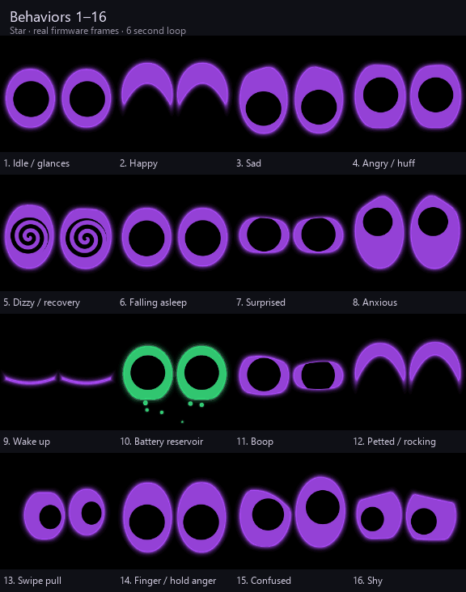
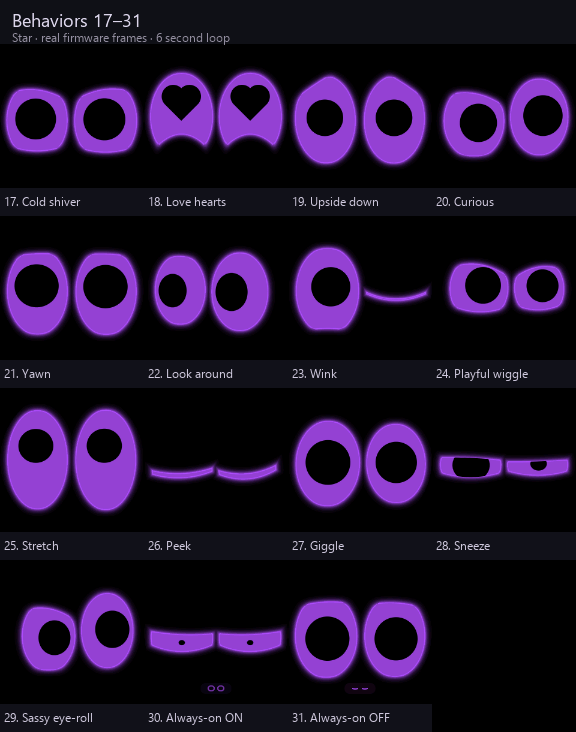
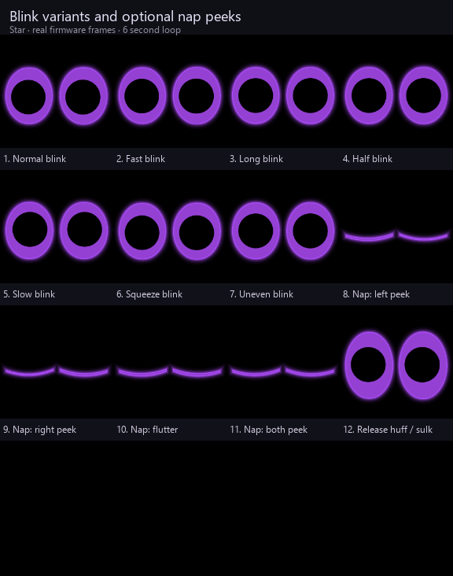

# Star Face

A wearable eye pet for the **Waveshare ESP32-S3-Touch-LCD-1.28**, adapted from [CREATURE's Starboy](https://hesjustalittleguy.com/) behaviors to the sensors in this board. The round 240 × 240 screen shows two big, friendly cartoon eyes on pure black in **bright purple at full charge, fading through yellow to red as charge falls**: brightly glowing purple ovals (with a purple halo) and simple solid black irises, drawn as smooth anti-aliased vector shapes (no stepped pixel edges). They react to the world through the motion sensor: they look toward the ground when tilted, stay level when the star is turned, keep looking at you when it is swung, get dizzy when it is shaken hard or spun, and startle when it is tossed. The eyes themselves carry the expressions: lids slide, slant and curve, the ovals stretch and tilt, irises dilate and tighten, turn into hearts or spin into spirals. (Optional rosy cheeks, a third colour, can be switched on with `CHEEK_BLUSH`.) There is no mouth. The face is drawn procedurally on the device and needs no image files, Wi-Fi, or cloud service. [Front-view preview](face-preview.svg) ([PNG](face-preview.png)).



**Design.** The look follows what makes cute characters inviting: [Groklet](https://x.com/grok/status/1914624830344978540) (Grok's big-eyed mascot), Meta Muse's [Jolly](https://fortune.com/2026/10/02/meta-openai-ai-agent-mascots-jolly-dots-trust/) (soft, round, rosy cheeks) and Japan's [LOVOT](https://www.engadget.com/2020-01-05-lovot-cuddle-robot-ces-2020.html) (huge layered anime eyes with involuntary eye movement): the baby-schema proportions of big eyes set a little low, huge dilated irises, solid pupils, round shapes, a gently happy default and frequent eye contact. The motion follows what reviewers describe of [Starboy](https://hesjustalittleguy.com/) (hand-animated eyes with natural blink rates and subtle gaze tremor that look toward the ground and sulk upside down): quick saccades that settle, a faint fixation tremor, lids that slide (not squash) and lower as the eyes look down, irises that foreshorten toward the side of the eyeball, breathing, and blinks that close fast and open slower. Expressions are sets of shape parameters the eyes blend between, an idea from [esp32-eyes](https://github.com/playfultechnology/esp32-eyes) and [RoboEyes](https://github.com/FluxGarage/RoboEyes).

## Animation gallery

All five sheets below are rendered by the same C++ eye and behavior code used on
Star. The ESP32 draws its own frames; it does not load or play these GIFs. Preview
playback is for comparing poses and choreography, not measuring device speed.
The latest connected-board benchmark measured about 22 FPS at rest and 19 FPS
while charging, including LCD transfer; input processing adds work.

### Expressions



### Behaviors: first set



### Behaviors: second set



### Motion, charging and wake effects


### Blinks and optional nap variants



The [animation inventory](ANIMATIONS.md) lists 15 expression bases, 31 behavior
states, seven blink types and optional variants. These are overlapping layers,
not counts to add together as distinct animations. Default deep sleep does not
show the optional screen-on nap peeks. See [preview tools](tools/preview) to regenerate.

## Charging status: known limitation

The liquid display and charging animations are ready to use. USB connection
classification remains a voltage-based heuristic and **is not fully fixed**.
In the October 15 physical unplug/replug test, stable-window battery readings
were about 4.149 V plugged in, 4.134 V disconnected, and 4.176 V after reconnecting.
Replugging was detected, but the detector had already reported not charging while
USB was connected before the test. A small near-full unplug can also be missed
or detected late. Simply lowering the sag threshold produced false disconnects
in a simulated still-connected load change, so the 15 mV threshold is retained.

Read the [test report and voltage capture](docs/charging-test-2026-10-15.md) for
method, replay results and limits. Percentage remains a filtered voltage estimate;
there is no current measurement or confirmation of full charge. Neither a high
percentage nor a green animation proves charge completion.

## What it does

**Manual center.** While awake, hold the first press still for two seconds to
center the eyes. Release to adopt that steady pose as the horizontal reference
and keep the gaze centered for five seconds. A fresh touch can interrupt this
rest; normal motion and idle gaze resume afterward. Dragging does not activate
manual centering. A tap followed by a second held press remains exclusively the
always-on toggle; it does not invoke manual centering. Critical sleep and the
battery screen keep priority.


**Wake-relative left/right gaze.** Each real wake starts a fresh horizontal
reference. Star waits for at least three valid readings spanning 150 ms of a
steady pose, then uses that pose as the initial horizontal eye center.
Shake, freefall and moving readings do not establish the center; the horizontal
gaze stays centered until a stable reference is available. Turning left/right
then moves the eyes relative to that pose, and returning to it centers them again.
Touch renewals, always-on toggles and sensor gaps do not themselves reset the
origin. About every 15 seconds, a two-second steady hold allows a periodic
refresh; the eyes ease to the new center over one second. Touch, walking,
closing, invalid reads or movement defer it, and movement interrupts a blend.
A deliberately held turn can therefore become the new center once that interval
and steady hold have elapsed. The next wake captures a new origin, including a charging wake
that interrupts closing. Up/down behavior keeps its existing gravity reference.

This compensates resting-angle differences with correctly configured sensor axes;
a replacement IMU still needs a compatible driver and screen-axis mapping.
It is not a compass or an automatic discovery of arbitrary sensor wiring.
At 115200 baud, `Wake gaze center captured` reports completion of the stable capture.
Host regressions cover 640 combinations of resting angle, flat/hanging posture,
screen-up polarity, configured XY mounting, read period and timer rollover.


**Sleep and directional tracking fixes.** The four-second face-down shutdown is disabled. Confirmed touchscreen contact renews the awake window and can cancel closing, including at its deadline. A newly detected plug-in also cancels visible closing and opens the green charging face with a fresh 30-second window; steady charging does not repeatedly renew it. Gyro noise, tilts, motion reactions, self-started animations and unconfirmed IRQs do not extend it. Pending touch is checked again during the WoM/LCD handshake, so a late input is not discarded while powering down. Critical battery shutdown remains authoritative. Failed or incomplete I2C reads and repeated sensor timestamps are rejected. The manufacturer's synchronized sample-lock protocol (CTRL7 syncSmpl with the required AHB clock-gating command) prevents a read from mixing consecutive sensor updates; normal clock gating is restored before WoM/deep sleep. Connected-board startup confirmed that locked reads allow stationary gyro calibration to complete. Gyro offset is calibrated from a still cold-boot interval and retained across deep sleep. The flat-up gravity sign is fixed to the measured mounting orientation of this board; it is not relearned from an arbitrary reset pose. `GAZE_IMU_ROTATION = 3` uses the user's USB-at-bottom viewing orientation; the recorded shake-wake axes stay independent. Directional motion takes priority over spontaneous gaze while resting level still allows idle looks. Shake impacts, inertia and tilt flicks use the same visual mapping. Flat Z-axis turns now move the gaze, and moving from upright to flat no longer leaves horizontal tilt tied to an old pose.


**Simple eyes.** The two catch-light dots are disabled. The purple eye shapes, solid black pupils, glow, and animated expressions carry the character. Looking and movement grow the eyes into more of the round panel, with farther whole-eye travel and stronger squash/stretch. Rendered looking silhouettes (including glow) use roughly 58-65% of the panel versus about 47-48% previously; the round-screen fit checks and corrects the full rotated contour.

**Animation polish.** The eye design is preserved, with brighter violet, a stronger halo, quicker blinks and gaze springs, more pronounced expression changes, and elastic hops and follow-through. Original peek, giggle, sneeze and cheeky eye-roll performances are available alongside winks, playful wiggles, stretches, curiosity, yawns and shy looks. Pickup after a short rest produces a peek, a double case knock a sneeze, and placing the screen face down an unimpressed eye roll. Touch keeps the existing polished choreography. Each performance has authored squash/stretch, asymmetric lids, gaze beats and recovery. Unattended behavior mostly consists of unhurried glances, blinks and small lid changes. Larger scenes respond to debounced movement, pickup after rest, walking transitions, long rest and battery changes rather than a timed random playlist. Sustained conditions do not keep replaying the same performance; environment events during touch are dropped instead of queued as a delayed show. Taps squash, pop open and wink before a giggle; surprise also includes a quick double take. The glow combines a compact bright rim and a wider soft halo in the current eye hue. Small breathing and body drift keep a resting creature visibly alive. A deliberate turn redirects its gaze quickly, including while it is doing a spontaneous gesture. A flat resting screen leaves room for small exploratory looks; holding a sideways tilt keeps the eyes looking outward, opposite the previous low-side response; these cues never renew sleep. Tilt and swing smoothing now uses elapsed time so responsiveness does not depend on display frame rate. Low charge still softens and slows the face. A small cached shade palette accelerates the glow and anti-aliasing without changing eye geometry. A fully opaque battery readout skips the hidden eyes. Full-width LCD windows send one contiguous block, and the SPI write path preserves the framebuffer rather than receiving into it. The frame cap is 60 FPS. The latest connected-board scene benchmark, including LCD transmission, measured 22.1 FPS at rest and 18.7 FPS charging with six staggered drops. The denser twelve-drop variant measured 16.0 FPS charging. These isolate render cost; normal input processing is additional. An unchanged opaque battery readout skips redraw, while charging redraws on cached liquid-animation steps.

The [manufacturer's specifications](https://docs.waveshare.com/ESP32-S3-Touch-LCD-1.28) confirm a 240x240 IPS LCD, CST816S touch and QMI8658 six-axis IMU. The available cues are touch, orientation, rotation, acceleration, steps, knocks, rocking, freefall, the IMU chip's temperature, and the board's voltage estimate. The reference [STARBOY](https://hesjustalittleguy.com/) inspires behavior; camera, microphone and external-world recognition require hardware this board does not contain.


**Liquid charging and always-on.** The battery is now a glowing reservoir with a gently sloshing fill surface, rising bubbles and heavier rounded percentage figures below it. Fill height reflects the estimate; animation never fabricates capacity. On unplug, existing face bubbles finish travelling into the eyes before the green fades back to the normal battery hue. The charge detector, gauge filtering and critical shutdown are preserved. Tap once, then hold the second press for about a second to toggle always-on; distinct eye cues and a dim, eye-colored sparkle inside each black pupil acknowledge the mode. This bypasses inactivity sleep while leaving touch/motion reactions active. Repeat to return to automatic sleep; restart also restores automatic sleep. Critical low battery still shuts it down. The [complete animation inventory](ANIMATIONS.md) lists the 15 expression bases, 31 behavior states and available variants.

**Current build: directional wake.** Normal serial messages and power-saving
sleep are restored (`RAW_IMU_SERIAL_ONLY = false`). Motion wake requires the
recorded left/right pattern with a 350 ms confirmation window: AY acceleration
dominates, GZ rotation dominates GY, and each produces four alternating strokes.
Both axes must keep reversing within 190 ms; slow bag/pants pendulum swings,
single bumps and separated short bursts cannot accumulate into a wake. Energy
tracking responds faster (180 ms smoothing and 80 ms initial settling), and
the dark-screen checker polls every 3 ms with recognition at roughly 100 Hz.
The carried forward/back
pattern is rejected during dark-screen confirmation and suppresses awake
discrete motion gestures once recognized; visual gaze and carrying context continue without resetting activity. The existing visual gaze
follower and touch interactions remain available. Recognized walking suppresses touch-like flick/knock/shake responses, so clothing movement cannot queue a downward swipe response; eye tracking and footstep bobbing continue. Each wake grants a 30-second window. Every confirmed touch sets exactly 15
seconds from that touch, indefinitely; touch can cancel closing. Motion remains visual while awake.

The supplied recordings have no timestamps and several clipped gyro values.
Replay checks at assumed 40, 55, and 80 ms intervals pass. Simulated deliberate
shakes at 3-5 Hz are accepted across read rates, phase offsets and timing jitter;
the standard 3.5 Hz trace is recognized about 390 ms after movement starts,
compared with roughly 1.7 seconds previously. This excludes CPU/sensor/LCD
startup and the eye-opening animation. Strong sideways dangling at 0.7-2.5 Hz,
walking/running bounce, noise, wrong-axis movement and the carried recording
stay dark. Physical testing on pants/bag is still needed. The gyro range is now ±2048 degrees/s to reduce
clipping. Thresholds are in `FaceConfig.h`; the detector is `LeftRightWake.h`.
Serial Monitor at **115200 baud** reports wake progress, AY/GZ energy shares,
GZ-to-GY ratio, and whether the motion was rejected as carrying.

**Optional six-axis diagnostics.** Set `RAW_IMU_SERIAL_ONLY = true` to print only
native signed register counts labeled **AX,AY,AZ,GX,GY,GZ**, at most every 40 ms.
Acceleration includes gravity (4096 counts/g); gyro measures rotation speed
(16 counts per degree/s at the new range). These are not absolute rotation
angles. The original hardware filter stays enabled; no software smoothing,
screen rotation, unit conversion, or gravity subtraction is applied. This
measurement mode starts awake and bypasses ordinary sleep, while preserving
critical battery shutdown. Startup clears retained WoM after ESP32 reset/upload,
and the checked diagnostic read skips failed I2C transfers and frozen sensor
timestamps. A reset can emit the ROM boot banner before the sketch starts.

- **Starts asleep with the display off.** A confirmed wake uses the existing eye-opening choreography. Idle glances cover the cardinal and diagonal directions, with tiny drift, irregular blinks, and occasional double blinks.
- **It follows the world** through the QMI8658 motion sensor, with or without touch:
  - **Tilt it any way** (left, right, forward, back, flat or upright) and the eyes follow with an outward left/right gaze and the existing up/down response, within a fraction of a second. Gravity and gyro are fused in screen coordinates; a held tilt keeps its direction. Flat-table and 90-degree upright hanging positions both center the gaze after a short settle. From upright, tipping 50 degrees up or 25 degrees down gives a full vertical look; a held lean keeps its direction.
  - The eyes stay square to the board (their line parallel to the edge with the USB-C port). Set `FACE_STAYS_LEVEL = true` to have the face roll back instead when the star is turned, staying level with the ground, or `FACE_ANGLE_DEG` if the enclosure holds the board turned.
  - **Rotate an upright screen left/right or tilt around a circle:** in-plane roll, pitch, and gyro pan combine into a full two-dimensional gaze; diagonals and circles use the same gaze springs as finger tracking. The eyes use the same gaze springs as finger tracking, with slow recentering to limit heading drift.
  - **Swing or turn it around** and the gaze follows the direction of the tilt/turn, with a short inertial eye-body recoil, then eases back.
  - **Shake it for about 1 second of recognized motion** for the dizzy spiral-eyed tumble (the eyes rattle and startle the whole time, so you see it building); a brief bump or very gentle shake only rattles and startles it, and turning or spinning it never makes it dizzy (`TWIST_MAKES_DIZZY`, `SPIN_MAKES_DIZZY` turn those back on).
  - **Toss it** (or drop it): weightless for a moment, it gets startled. **Bump or nudge it** while it is calm: it notices with a quick widen and blink. **Pick it up after it has rested** a while: "oh!", then a happy hello.
  - **Walk with it:** it feels your footsteps. The eyes bob with each step, smile a little, look around more and keep watching the world go by; running makes it wide-eyed. Carrying does not reset sleep (`WALKING_KEEPS_AWAKE = false`).
  - **Hold it up in front of you:** it pays attention, looks at you more, its pupils widen and it does happy blinks, curious looks and the odd shy glance, This visual attention does not reset sleep; small sensor noise on a table cannot keep it awake.
  - **Leave it alone:** right up until it falls asleep its eyes keep moving (a new look every half second to few seconds, little micro-expressions in between), and every 2.4-4.8 seconds it does something by itself (looks around the room, a curious sideways look, a yawn, a happy squint, a puzzled look); the longer it is left alone, the more it gets bored and yawns, then it gets drowsy and falls asleep (`IDLE_SLEEP_MS`, 15 s after the last interaction).
  - **Warm** (pocket, hand, sun; the IMU chip above `HOT_C`): lazy yawns now and then. **Cold:** it shivers.
- The pupils lead and the whole eyes follow a beat later; the second eye trails a fraction behind the first, fast moves squash and stretch the eyes slightly, and the eye on the side being looked toward grows a little (curious), so gaze reads as a small head turn. Left alone it looks around (often back at you), blinks at random (with doubles, half blinks and slow blinks) and shows brief micro-expressions: a squint, a curious lift, a sceptical look.
- **Touch:** while a finger is on the screen the eyes follow it wherever it moves. A tap makes the nearer eye flinch first, then both rebound and settle; a double tap surprises them; **three or four quick taps** play the existing angry animation for 1.9 seconds. **Five consecutive screen taps** (no more than 650 ms apart) start a protected 3.5-second angry pause: the pointer stays still and reactions cannot restart its anger. Separate screen taps keep counting during the pause, so **ten consecutive taps while awake** can show the battery. It then resumes normal interaction and its usual brief sulk. Battery shutdown takes precedence over the pause. Touch still renews the sleep timer during the pause. A short gentle press is a pet (happy crescent eyes). **A steady single hold of two seconds recenters it**; after release, it stays centered for five seconds. Before that threshold a held finger can briefly lower the lids. A dragged hold keeps its normal finger-following response.
- **Everything works without the touch screen** (for example behind a protective Lexan cover), using the motion sensor:

  | Touch | Motion instead |
  | --- | --- |
  | Tap 1 / 2 / 3 / 4 times (boop, surprised, angry, angry) | **Knock on the case** 1 / 2 / 3 / 4 times; the eye nearer the knock flinches |
  | Swipe up / down / left / right (battery, sad, shy, happy) | **Tip it** up / down / left / right **and straight back** |
  | Gentle press (petted) | **Rock it gently** side to side, like cradling it; it stays content while you rock |
  | Hold a finger on it (worried, then angrier and angrier) | **Hold it upside down** (relative to how you usually hold it, which it learns); turn it back over and it huffs, then cools off |
  | Wake from sleep | **Touch the screen once or give a brief, brisk left/right shake** |
  | — | Normal sleep follows inactivity; orientation does not force a shutdown |

  Knocks and sustained shakes are recognized by a small task on the ESP32's second core that reads the motion sensor about 330 times a second (a knock is over in milliseconds); recognition is independent of display frame time. It also switches on the sensor's ~54 Hz low-pass filter, which Waveshare's driver leaves off by mistake. A knock only counts when the star was still just before and settles right after, so walking, running, shaking and swinging it never count. Quick twists only cause dizziness when `TWIST_MAKES_DIZZY` is enabled; slower swings are rocking. Touch works while awake and wakes the creature from sleep, as in the testing branch. A held finger keeps renewing the sleep timer (`TOUCH_STUCK_MS = 0`); a nonzero `TOUCH_STUCK_MS` restores the optional stuck-touch cutoff.
- A swipe pulls and stretches the eyes in its direction, then releases them into an expression. The direction is taken from **the last flick of your finger** before it lifts, so you can press anywhere, wander around, and flick whichever way you like. **Up** calls `showBatteryLevel(percent)`, the same display as **ten consecutive taps while awake** (no more than 650 ms apart). The eyes ease into a rounded liquid reservoir over 280 ms. The figures below show the estimated percentage at 1% increments (including 73%, 85%, and 100%); vertical fill reflects that number. It stays readable for 3.64 seconds, then eases back into the eyes over 280 ms. Unknown readings show `--%` with an empty reservoir; no percentage is invented when USB hides the cell voltage. The entire sequence lasts 4.2 seconds. Further touch renews sleep while the readout finishes; critical battery sleep can still interrupt it. **Down** makes them sad, **left** shy, and **right** delighted. The readout is drawn in the existing framebuffer, so no image files or extra display buffers are required.
- **Expressions** (all kept; they morph smoothly into each other): neutral, happy (crescent "^" eyes), sad, angry, focused (determined), surprised (wide and round with small pupils), sleepy, squint, curious (one eye wide, one narrowed), confused, suspicious, worried, annoyed, love (heart pupils) and dizzy (spinning spiral pupils).
- **Carried around:** walking does not reset sleep. Routine movement can wake the CPU briefly, with the screen dark, for gesture verification. The recorded forward/back motion is rejected in replay; confirm with the physical carrying test.
- **Shaking** gets an instant reaction: from the first stroke the eyes widen in alarm, their pupils shrink and jiggle, and each stroke throws the eyes the other way. A very gentle shake only rattles and startles it; moderate shaking can now trigger the full reaction, and turning, twisting or spinning it never makes it dizzy. Only **shaking it for about 1 second of recognized motion** (moderate back-and-forth motion, with four alternating strokes; brief uneven pauses up to roughly half a second are tolerated, while longer pauses restart recognition) sends the eyes into a wobble and a slowing tumble with **spinning spiral pupils**, followed by an angry glare that cools off over a few seconds — "shake him and he gets dizzy and mad at you". Keep shaking and the tumble starts again. The same startled, dizzy wake sequence plays after a sustained shake wakes it from sleep. A face-down pause makes one eye narrow. If the IMU's own chip temperature remains below 18 °C for eight seconds, the eyes shiver; this reads chip temperature and may lag or differ from the surrounding air.
- **Power-saving sleep:** An untouched wake lasts **30 seconds**. The first subsequent confirmed touch sets a **15-second inactivity deadline**, even when it occurs early in the initial window. Every later touch or confirmed held contact restarts those 15 seconds. Motion, walking, tilt gaze, knocks, self-animation and an IRQ without a valid touch report cannot extend the session. Closing starts 5.4 seconds before the deadline and finishes with the LCD asleep, backlight off and CPU in deep sleep. Confirmed touch can interrupt closing at any stage; critical low-battery sleep still wins. Repeated touching keeps it awake indefinitely without banking extra time for rapid taps.
- From deep sleep, **touch the screen once** to wake. The touch controller keeps scanning while the ESP32 and LCD sleep. A touch interrupt is latched from the start of CPU wake and takes priority over motion-wake checking, so touching during IMU startup is retained. This uses more touch-controller standby power than its automatic low-power scan. A quick tap or a press wakes it without waiting for a release or a second touch. Alternatively, perform the recorded
  **left/right shake for about 1.5 seconds** (25% shorter than before). The CPU checks motion with the
  screen dark: gravity-free AY energy must be at least 50% of acceleration
  energy, GZ at least 42% of rotation energy and 1.35 times GY energy, with
  sustained strength and repeated AY/GZ reversals. The supplied forward/back
  trace fails these combined checks. A single bump, short shake, pure rotation,
  or translation without matching rotation cannot confirm this gesture.

The face layout is symmetric at rest. Small differences between eyes during expressions are intentional. The physical shell preview is a visual mockup based on the screenshots; no CAD geometry was altered. Starboy's camera, microphone, haptic motor, and proprietary device-to-device protocol are absent from this Waveshare board, so its hand-gesture, sound, vibration, and Starboy-to-Starboy features cannot run here without new hardware or protocol information. The swipe and tap mappings provide hands-on substitutes for some of those interactions.

## Battery expressions and shutdown

Charge changes the eye color gradually at every percentage point: bright purple at 100%, yellow at 50%, red at 10% and below. Every 10% drained adds a heavier tired pose, softened by animation and a 2% recovery deadband. Red eyes look exhausted, with heavy lids and slow blinks. Touch and motion expressions keep their existing choreography. Charge adds a smoothly blended layer:

**Charging and responsiveness:** awake connection checks run every 100 ms on the face, through closing, and on the battery screen. Large voltage rises retain two-reading confirmation; small abrupt 25 mV rises need three elevated observations. A 40 mV drop needs two observations. Near full, unplugging only makes a small step followed by a slow sag, which the old sliding reference followed down so the face stayed green. The charging reference is now the smoothed peak voltage and may only creep down 1.8 mV per minute (a plugged-in cell holds or gains voltage); once the smoothed and current readings both stay 15 mV below it for a second, the cable counts as unplugged. ADC noise, steady charging and our own load steps while charging are rejected; the recent reference and last observation survive sleep/reset. Cable classification never resets the percentage. Battery-voltage inference cannot guarantee USB presence at a steady-voltage cold boot or prove charge completion.

Charging has a softly joyful resting pose, green eyes and a subtle breath in the existing halo. The colored body is slightly dimmer than its bright, narrow rim for a glassy appearance; the black iris stays solid. Rounded contours, curved lids and their spring animation are shared by every expression. While charging, a stream of green bubbles (`CHARGE_BUBBLES` per eye) rises from the USB-C port at the bottom edge, each trip with its own size, speed and sway. Touching bubbles melt into each other, and each one pours into the lower edge of its eye with a gooey neck. Free bubbles are plain circles; only bubbles about to join an eye pay for the eye-distance blend, so the cost stays small. The bubbles fade with the eyes' openness. Once unplugging is inferred, new drops stop launching and existing drops finish merging into the eyes. Ordinary frame intervals up to 120 ms now advance the sub-stepped animation by their actual duration, avoiding the former slow-motion behavior below 20 FPS. Unplug confirmation changes the battery readout color immediately; the face stays green until the last scheduled drop arrives, then fades to its normal charge-dependent hue.

The battery screen uses a large rounded reservoir in the current charge color (purple, yellow, red; green while charging). Liquid fills from the bottom, with a gentle meniscus wave and small rising bubbles while charging. Rounded percentage figures sit below it without a backing badge. The 280 ms entry/exit and 4.2-second total duration are preserved. An opaque unchanged readout is cached until percentage, connection state, liquid-animation step, visibility or invalidation changes.

**Percentage estimation:** cable classification never resets the percentage. A separate time-based voltage filter feeds the existing approximate single-cell lithium lookup curve. The gauge holds through 20-second connection/load transitions, then changes by at most one percentage point per ten seconds of accepted observations. A one-point deadband prevents target noise around 87/88% from flickering. This is a display/estimator correction limit, not an assumed physical charging rate: no capacity is added from elapsed time alone. Charging estimates can rise toward their filtered voltage target; they do not fall while charging or remain frozen indefinitely. Charging terminal voltage alone is capped at a 99% target because it cannot prove charger termination. The final 98-to-99% correction bypasses the one-point noise deadband, while keeping the same settling and rate limits. Battery-only upward corrections require a minute of settled observations after the transition. Missed polls and taps cannot supply extra votes or large catch-up jumps. Unknown charge without a usable estimate shows `--%`.

The entire percentage, voltage-filter, charging, transition and correction state is versioned and retained through deep sleep. One atomic NVS record replaces separate voltage/percentage writes; charge changes, periodic checkpoints and changed percentages before sleep preserve reset continuity. Existing voltage/percentage preferences migrate once. The historical probe minimum is no longer reused as the current state of charge. Critical shutdown and recovery use the immediate valid voltage reading, independent of the smoothed display percentage.

During an authorized USB upload, the host can send the exact serial line `USB_POWER=1` to initialize independently confirmed connection state when a near-full cell has no usable voltage rise. This preserves the percentage, checkpoints the complete state, and does not alter voltage calibration or sleep deadlines. Subsequent unplug/replug detection uses the existing voltage-trend logic; the face does not require a continuously running host helper.

This is voltage-trend inference, not a reliable USB or charger status sensor: the charger STAT pin is not wired to the CPU, and the measured UART bridge RX input stayed high both plugged and unplugged. Load changes can imitate charging, and a steady full battery or a boot without a prior baseline can make connection state ambiguous. A newly detected plug-in during visible eye closing cancels that sequence and grants one 30-second wake window. USB does not add a wake source once the ESP32 has entered deep sleep; steady charging retains ordinary inactivity sleep.

| Estimated charge | Behavior |
| --- | --- |
| 100% / unknown | Bright purple eyes; normal personality |
| 90%, 80%, 70%, 60% | Gradually warmer color; another tired pose at each 10% drop |
| 50% | Yellow eyes with visibly heavier lids |
| 40%, 30%, 20% | Yellow fades toward red; progressively droopier, slower eyes |
| 10% or lower | Red, exhausted eyes; heavy lids and slow blinks |
| 3% or lower | Finish closing, LCD sleep-in, backlight off, ESP32 deep sleep; all gesture wake disabled |

Critical sleep briefly checks charge once a minute with the screen dark. It remains asleep until the immediate voltage estimate reaches 8% or the charging trend is confirmed, then resumes normal sleep awaiting interaction. Sampling, transition settling, percentage correction and charge-trend thresholds are in `FaceConfig.h`.

The [Rev3 board schematic](https://files.waveshare.com/wiki/ESP32-S3-Touch-LCD-1.28/ESP32-S3-Touch-LCD-1.28-Sch.pdf) connects GPIO1 through a 200k/100k divider to **VBAT**. Waveshare specifies a [3.7 V battery interface](https://docs.waveshare.com/ESP32-S3-Touch-LCD-1.28/FAQ); this firmware assumes the ordinary single-cell 4.2 V lithium charge range. The exact attached cell's capacity, model, charge current and battery temperature cannot be read through this ADC. The lookup curve is an approximation, not a cell-specific characterization. Terminal voltage changes with charging and load, so stable software behavior does not establish accurate remaining mAh or runtime. [Fuel gauges use additional current, capacity and battery-characterization information](https://www.ti.com/product-category/battery-management-ics/battery-fuel-gauges/overview.html). This is software power saving, not a battery disconnect or a substitute for the cell's protection circuit.

## Existing hardware kept intact

The project targets the **Waveshare ESP32-S3-Touch-LCD-1.28** with a **240×240 GC9A01A LCD**. It keeps Waveshare's `LCD_1in28` and `DEV_Config` SPI driver, `CST816S` touch driver, and `QMI8658` IMU driver. LCD pins remain DC 8, CS 9, clock 10, MOSI 11, MISO 12, reset 14, and backlight 2. I²C remains SDA 6 and SCL 7; touch reset/IRQ are 13/5, QMI8658 INT2 is GPIO3, and battery ADC is GPIO1. The full-screen RGB565 buffer is allocated once at startup and reused; each frame is composed off-screen and only the changed window is pushed, so there is no flicker. The frame cap is 60 FPS. Interior pixels take a cheap fast path and only edge pixels get the full anti-aliasing math. The latest connected-board benchmark measured 22.1 FPS at rest and 18.7 FPS while charging, including LCD transmission. An unchanged opaque battery readout skips rendering and transfer; this cache hit is not a continuous frame-rate measurement. Throughput depends on the expression and input; set `LOG_FPS` in `StarFace.ino` to print it. The SPI framebuffer integrity checks reported no changes after transmission.

## Upload

1. Open `StarFace/StarFace.ino` in Arduino IDE. All board-specific driver files are beside the sketch, so no extra display or IMU library is needed.
2. Install **esp32 by Espressif Systems** in Boards Manager (checked with core 3.3). Select **ESP32S3 Dev Module**. Set **Flash Size: 16 MB**, **PSRAM: QSPI PSRAM**, and **USB CDC On Boot: Disabled**. The Waveshare board's USB-C port uses a USB-to-serial chip.
3. Connect the board over USB-C, choose its serial port, and click **Upload**. If it does not enter the bootloader automatically, hold **BOOT**, press **RESET**, release **BOOT**, then upload.

From the repository root, the equivalent Arduino CLI build and upload are:

```sh
arduino-cli compile --fqbn esp32:esp32:esp32s3:FlashSize=16M,PSRAM=enabled,CDCOnBoot=default --build-path build/firmware Keychains/Star/StarFace
arduino-cli upload --fqbn esp32:esp32:esp32s3:FlashSize=16M,PSRAM=enabled,CDCOnBoot=default --port YOUR_PORT --input-dir build/firmware Keychains/Star/StarFace
```

Replace `YOUR_PORT` with the board's port (for example `COM10` on Windows).
The current build was checked with Espressif core 3.3.11. The normal firmware
starts asleep; touch once or use the deliberate left/right shake to wake it.
The always-on mode is off after restart.

The sketch uses the pin mapping and GC9A01A, CST816S, and QMI8658 driver code from the [Waveshare example package](https://docs.waveshare.com/ESP32-S3-Touch-LCD-1.28/Resources-And-Documents). The included driver files retain their original notices.

## Using the eyes in code

The eyes are a self-contained animation system (`Eyes`), driven by a behaviour layer (`CreatureAnimator`) that turns touch, motion and time into moods. You can also drive them yourself from anywhere in the sketch; every call is animated, so the eyes always ease from wherever they are:

```cpp
eyes.setExpression(HAPPY);          // NEUTRAL, HAPPY, SAD, ANGRY, FOCUSED, SURPRISED, SLEEPY, SQUINT,
                                    // CURIOUS, CONFUSED, SUSPICIOUS, WORRIED, ANNOYED, LOVE, DIZZY
eyes.setExpression(ANGRY, 0.5f);    // optional intensity (0 neutral .. 1 full .. ~1.3) and speed
eyes.setExpressionMix(FOCUSED, ANGRY, 0.7f); // a blend of two
eyes.lookAt(0.6f, -0.2f);           // -1..1: x right, y down (optional speed)
eyes.lookAtPoint(200, 120);         // a point on the screen, px
eyes.lookAround();                  // hand the gaze back to the idle behaviour
eyes.blink();                       // or blink(Blinker::SLOW), wink(0)
eyes.setIdle(false);                // stop the automatic look-arounds and micro-expressions
eyes.setAutoBlink(false);
```

The behaviour layer sets an expression when something happens (a tap, a shake, falling asleep) and otherwise leaves the eyes alone, so a call of yours stays in effect until the creature reacts to something. While idle behaviour is on, a single `lookAt()` holds for `Eyes::IDLE_RESUME_MS` (2.5 s) before the eyes wander again; call it every frame to track something.

| File | Role |
| --- | --- |
| `Eyes.h/.cpp` | The public API; layers expression, openness, blinks, gaze, physics and effects into each frame and keeps the eyes on the round screen |
| `EyeShape.h` | The shape of one eye (size, roundness, tilt, bend, upper and lower lids, pupil, heart, spiral) and `ShapeSpring`, which springs every field so shapes morph |
| `Expressions.h/.cpp` | Each expression as a pair of `EyeShape`s plus how fast and springy its arrival is |
| `Blinker.h` | Blinks: fast accelerating close, slower decelerating open, random timing and blink types |
| `GazeController.h` | Gaze: pupils lead, the eyes follow, micro-saccades |
| `IdleBehavior.h` | Idle look-arounds, glances and micro-expressions |
| `EyeRenderer.h/.cpp` | Draws the eyes as anti-aliased vector shapes |
| `MotionGestures.h` | Knocks, tilt flicks, rocking, and `WorldFollower` (tilt gaze, level roll, swing, spin, toss) |
| `AnimMath.h` | Springs, easing curves, smooth noise |
| `CreatureAnimator.h/.cpp` | Moods, wake and sleep scripts, dizzy tumble, shake rattle, touch reactions, backlight |

## How the eyes are drawn

`EyeRenderer` builds each eye from smooth shapes, not sprites. Each eye is an oval (optionally tilted and bent into an arc) with an upper and a lower lid sliding over it, each a curved line that arches around the eyeball, with rounded corners where a lid meets the outline. Every pixel gets a signed distance to that shape, computed in floating point, so outlines move and morph continuously in sub-pixel steps. The iris is a circle that narrows as it turns toward the side of the eyeball, with catch-lights disabled (`GLINT_SIZE = 0`; an optional dark centre is controlled by `PUPIL_CORE`); it blends into a heart or a spinning spiral by mixing distance fields. The glow is the same distance seen from outside: a halo of the eye colour that fades to black over `GLOW_SIZE`.

The distance also gives each edge pixel its exact coverage, so a pixel the outline passes through gets the matching blend of the colours on either side (eye, iris and black). That is what makes the curves look continuous instead of stepped on a 240-pixel screen. The palette stays strict: every pixel is a blend of black, `EYE_COLOR` and `PUPIL_COLOR` (edges and the glow), and the desktop tests check every rendered pixel to prove it. Blinks close the lids over the eye until they meet in a soft curved line; the iris tucks away first, so the shut eye is one clean stroke.

The per-pixel loop avoids float division and `sqrtf`, which are slow on the ESP32. Each frame is composed off-screen and only the changed rectangle is pushed. Sizes are fractions of the screen and positions are relative to its centre, so changing `SCREEN_WIDTH`/`SCREEN_HEIGHT` (and `SCREEN_IS_ROUND`) re-lays out the face; on a round panel every eye is fitted to a soft circular safe area each frame, then the pair reserves a clear gap between their rotated, curved outlines. Gaze, surprise and impacts ease against the edge without crowding the eyes together.

[`tools/preview`](tools/preview) builds the same code on a PC and writes frames. Use it to check shapes and timing without flashing.

## Tuning

Everything visual and behavioral is grouped in `StarFace/FaceConfig.h`:

| To change | Constant |
| --- | --- |
| Colours, glow and smoothing | `EYE_COLOR` (eyes, glow, catch-lights), `PUPIL_COLOR` (irises, hearts, spirals), `GLOW`, `GLOW_STRENGTH`, `GLOW_SIZE`, `ANTI_ALIAS`, `CHEEK_BLUSH`, `CHEEK_COLOR` |
| Eye size | `EYE_WIDTH`, `EYE_HEIGHT` (fractions of the screen) |
| Eye spacing and vertical position | `EYE_SPACING`, `MIN_EYE_GAP`, `EYE_OFFSET_Y` |
| Iris, its dark centre, catch-lights, pupil life | `PUPIL_SIZE`, `PUPIL_CORE`, `GLINT_SIZE`, `PUPIL_LIFE` |
| Following the world | `GAZE_IMU_ROTATION` (sensor to display), `IMU_ROTATION` (recorded gesture frame), `HORIZONTAL_GAZE_SIGN`, `HORIZONTAL_GAZE_FULL_DEG`, `HORIZONTAL_GAZE_NEUTRAL_DEG`, `HORIZONTAL_GAZE_SMOOTH_S`, `HORIZONTAL_SWING_GAZE`, `VERTICAL_GAZE_FULL_DEG`, `DOWNWARD_GAZE_FULL_DEG`, `GAZE_NEUTRAL_ZONE_DEG`, `GAZE_POSE_SETTLE_MS`, `FACE_STAYS_LEVEL`, `FACE_ROLL_MAX`, `FACE_ANGLE_DEG`, `SWING_GAZE`, `SPIN_TURNS_FOR_DIZZY`, `FREEFALL_MS`, `STEP_MS2`, `WALKING_KEEPS_AWAKE`, `HOT_C` |
| Maximum eye movement | `MAX_PUPIL_MOVE`, `MAX_EYE_MOVE_X`, `MAX_EYE_MOVE_Y`, `MAX_EXPRESSION_EXPANSION`, `MAX_EYE_HEIGHT_EXPANSION`, `ACTIVE_EYE_WIDTH_GROW`, `ACTIVE_EYE_HEIGHT_GROW` |
| Animation speed | `ANIMATION_SPEED` (above 1 is snappier), `EXPRESSION_BLEND_SPEED`, `GAZE_SPEED` |
| Expression strength | `EXPRESSION_INTENSITY` (the shapes themselves are in `Expressions.cpp`) |
| Blink speed and frequency | `BLINK_CLOSE_MS`, `BLINK_OPEN_MS`, `BLINK_MIN_MS`, `BLINK_MAX_MS`, `DOUBLE_BLINK_CHANCE` |
| Idle restlessness | `IDLE_LIVELINESS`, `SQUASH_STRETCH` |
| Screen | `SCREEN_WIDTH`, `SCREEN_HEIGHT`, `SCREEN_IS_ROUND`, `SAFE_MARGIN` |
| Knocks, tilt flicks, rocking, upside down, face-down sleep | `KNOCK_MS2` (lower = more sensitive), `KNOCK_QUIET_MS2`, `KNOCK_QUIET_BEFORE_MS`, `KNOCK_GAP_MS`, `FLICK_START_RAD_S`, `FLICK_MIN_TILT_MS2`, `FLICK_MAX_MS`, `ROCK_MIN_HALF_MS`, `ROCK_MAX_HALF_MS`, `ROCK_SWINGS`, `UPSIDE_DOWN_MS`, `FACE_DOWN_SLEEP_MS` |
| Touch on or off, stuck touches | `TOUCH_ENABLED`, `TOUCH_STUCK_MS` |
| Touch, swipes and hold anger | `TAP_MAX_MS`, `TAP_MAX_MOVE_PX`, `SWIPE_MIN_PX`, `SWIPE_MIN_SPEED`, `SWIPE_MAX_SHORT_MS`, `HOLD_ANGER_START_MS`, `HOLD_ANGER_FULL_MS`, `TOUCH_RELEASE_TIMEOUT_MS` |
| Shake sensitivity | `SHAKE_DIZZY_HOLD_MS` (1 s of recognized shaking), `SHAKE_DIZZY_STRENGTH`, `SHAKE_DIZZY_DROPOUT_MS`, `SHAKE_DIZZY_SWINGS`, `SHAKE_STROKE_MS2`, `TWIST_MAKES_DIZZY`, `SPIN_MAKES_DIZZY`, `SHAKE_GAP_MS`, `SHAKE_NOISE_MS2`, `SHAKE_FULL_MS2`, `BUMP_MS2`, `PICKUP_MS2` |
| Periodic horizontal recentering | `HORIZONTAL_RECENTER_INTERVAL_MS` (15 s), `HORIZONTAL_RECENTER_STILL_MS` (2 s), `HORIZONTAL_RECENTER_BLEND_MS` (1 s), `HORIZONTAL_RECENTER_GYRO_RAD_S` |
| Sleep and wake | `AUTO_DEEP_SLEEP`, `IDLE_SLEEP_MS`, `WAKE_AWAKE_MS`, `IDLE_NAP_MS`, `TOUCH_WAKE_TAPS`, `TOUCH_WAKE_WINDOW_MS`, `DIRECTIONAL_WAKE_HOLD_MS`, `WAKE_DIRECTION_SETTLE_MS`, `WAKE_DIRECTION_SWINGS`, `WAKE_REVERSAL_MIN_MS`, `WAKE_REVERSAL_MAX_MS`, `WAKE_AY_*`, `WAKE_GZ_*`, `BACKLIGHT_PERCENT`, `NAP_BACKLIGHT_PERCENT` |
| Anger cool-down | `ANGER_COOLDOWN_S` |

Hardware-specific settings stay in `StarFace.ino`:

| To change | Constant |
| --- | --- |
| Motion alarm that wakes the CPU from deep sleep | `WOM_THRESHOLD_MG` |
| Twist sensitivity (in `ShakeDetector.h`) | `TWIST_RATE_RAD_S`, `TWIST_MIN_HALF_TURN_RAD`, `TWIST_REVERSALS_TO_WAKE`, `TWIST_WINDOW_MS` |


While awake, each counted twist reversal needs roughly 14° of turning at 69°/s or faster, on the same X or Y gyro axis. `WOM_THRESHOLD_MG = 200` sets the low-power accelerometer's coarse motion alert; routine worn motion can wake the CPU briefly, but a brief, brisk directional shake is required before motion lights the display (the log prints its progress). `LOG_SHAKE` in `StarFace.ino` (on by default) prints the shake strength over serial at 115200 baud while it is being shaken, and each knock (with its strength), flick, rocking spell and upside-down/face-down gesture, and the boot log says whether the motion sensor was found. If shaking feels too hard or too easy, compare the printed strength with `SHAKE_DIZZY_STRENGTH` (the log also shows how long the current shake has been kept up) and adjust it or `SHAKE_DIZZY_HOLD_MS`; waking from sleep uses `DIRECTIONAL_WAKE_HOLD_MS`, `WAKE_DIRECTION_SWINGS`, `WAKE_REVERSAL_*`, `WAKE_AY_*` and `WAKE_GZ_*` (the legacy generic `SHAKE_WAKE_*` settings remain for regression tests). If knocks don't register, lower `KNOCK_MS2` (2.5 catches even a fingernail flick); if setting it down counts as a knock, raise it. Visual directions use `GAZE_IMU_ROTATION` in `FaceConfig.h`, independently of the recorded shake detector frame. With USB at the bottom, the current fusion mapping is canonical Y to fusion X and -X to fusion Y (quarter turn 3). Both acceleration and gyro vectors use this same right-handed rotation before fusion; the measured screen-up convention is applied when projecting gaze relative to the table or hanging posture. Absolute gravity components avoid false vertical wrap jumps when rolled sideways. Flick, impact, inertia and knock effects use that mounting rotation followed by a conversion into downward pixel Y; gyro fusion retains its right-handed frame. The quarter turn is inferred from the reported left tilt causing downward gaze and right tilt causing upward gaze in the previous mapping. Upright hanging at 90 degrees and resting flat are both neutral vertical postures; the horizontal center comes from the stable wake pose. Gravity selects the table or hanging reference with hysteresis and a 120 ms pose debounce, even during handling or walking. The handover eases for 300 ms; it never waits for the gyro to become perfectly quiet. Left/right gaze is inverted after fusion, including heading and the horizontal reflex. The active firmware captures a fresh stable horizontal origin on every real wake instead of using the fixed enclosure trim as its session center. Heading retains the complete accumulated turn; only visible gaze saturates. Held turns stay put until a periodic steady-hold refresh adopts the new center. Returning from a large turn retraces correctly before that refresh, and brief sensor gaps preserve the heading. Its neutral zone is 4 degrees, full range is 30 degrees, and smoothing is 35 ms, so smaller sideways turns respond more visibly. Vertical gaze retains the 8-degree neutral zone and 65 ms smoothing; full upward gaze occurs at 50 degrees and full downward gaze at 25 degrees. Side-on rolling suppresses ambiguous vertical tilt rather than inventing a 180-degree pitch change. `VERTICAL_GAZE_FULL_DEG = 50` sets the upward range, while `DOWNWARD_GAZE_FULL_DEG = 25` gives a full downward look at the previous halfway angle. A wake at 40 or 140 degrees uses the hanging reference, so it still looks up/down rather than incorrectly recentering that lean. The QMI8658 axes and angular-rate signs are described in section 2.4 of the [manufacturer datasheet](https://files.waveshare.com/wiki/common/QMI8658C_datasheet_rev_0.9.pdf). The detection logic lives in `ShakeDetector.h` and `MotionGestures.h` and is tested on a PC by `tools/preview/run_tests.sh`. `BACKLIGHT_PERCENT` sets active backlight brightness.

This sketch restores the testing branch’s GPIO3 (QMI8658 INT2) and GPIO5 (CST816S touch IRQ) active-low deep-sleep wake inputs. The touch chip remains in automatic standby; normal sleep does not send its full sleep command. The unsuccessful swivel-only path and one-second timer polling are removed. When an IMU motion interrupt wakes the CPU, the display stays dark until a brisk left/right shake is confirmed. Critical battery sleep still disables both gesture wake sources and checks charge once a minute. The restoration was compiled and checked in host simulations, then uploaded to the connected ESP32-S3 on COM10; physical wake acceptance and walking rejection must also be checked on the assembled keychain.

The [research and animation notes](RESEARCH.md) explain what the reference product appears to do, what was observed versus advertised, and why this face has its own reactions.
