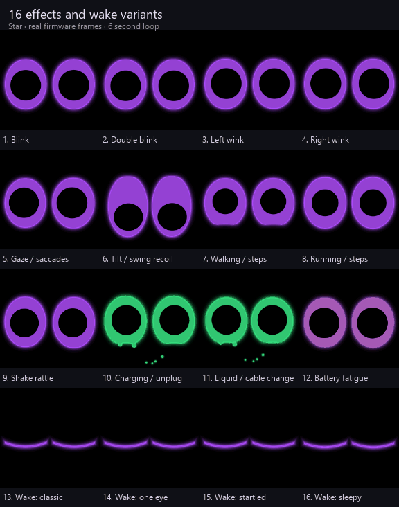

# Glowlings

Little round-screen creatures with big glowing eyes. They come in two sizes:
**keychains** you carry around and **desk buddies** that sit next to you.

| Glowling | Kind | Hardware | Folder |
| --- | --- | --- | --- |
| **Star** | Keychain | Waveshare ESP32-S3-Touch-LCD-1.28 (240 × 240 round) | [Keychains/Star](Keychains/Star) |
| *(coming soon)* | Desk buddy | | [DeskBuddies](DeskBuddies) |

Each Glowling lives in its own folder with its firmware, tools, tests and notes.

## Star: liquid charging and always-on

Star has a glowing liquid battery display, a joyful charging pose, and six green
bubbles that rise from the USB-C edge and merge into the eyes. When an unplug is
detected, the remaining bubbles finish their journey before the green fades.
Tap once, then hold the second press to toggle always-on; repeat to restore
inactivity sleep. Critical low battery still forces shutdown.

These previews use the actual firmware renderer; GIF playback does not represent
ESP32 frame rate. See Star's [README and five GIF sheets](Keychains/Star/README.md#animation-gallery)
and [complete animation inventory](Keychains/Star/ANIMATIONS.md).

**Known charging limitation:** connection state is inferred from battery voltage,
not a USB or charger-status signal. Near-full unplugging and an already-connected
boot can still be missed. The [physical test report](Keychains/Star/docs/charging-test-2026-10-15.md)
records the measurements and explains why a more sensitive threshold was rejected.
The battery percentage is an estimate, and the firmware cannot confirm charge completion.

## License

[MIT](LICENSE) © Aloe ([AloeVeraZ](https://github.com/AloeVeraZ)). You can copy, change and share this project, as long as you keep the copyright notice and give credit.
